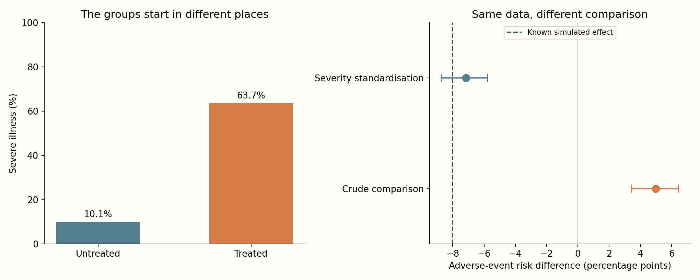
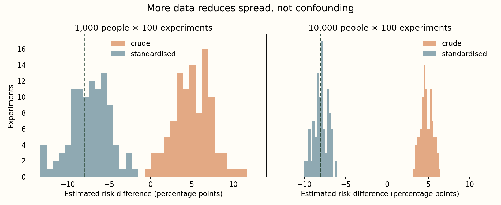

# When a helpful treatment looks harmful

**A controlled example of how the wrong comparison can reverse an answer.**

I built a fictional population in which treatment reduces adverse events in both severity groups. Then I made people with severe illness more likely to receive it. The resulting dataset lets me ask a question with a known answer: can an analysis recover the treatment effect when the groups start out different?



## The reversal

The true population effect in this simulation is **−8 percentage points**. In the primary sample of 10,000 people:

| Comparison | Risk difference | Approximate 95% bootstrap interval |
|---|---:|---:|
| Crude: treated versus untreated | **+4.97 pp** | +3.42 to +6.44 pp |
| Standardised to the same severity mix | **−7.16 pp** | −8.73 to −5.77 pp |

Positive values mean more adverse events. The crude comparison reverses the sign because the treated group contains more severely ill people. Standardisation compares both treatment conditions under the same 70% mild / 30% severe population mix. These intervals come from 500 person-level resamples; none had an undefined comparison.

## Why more observations do not fix it



Across 100 experiments at each sample size, increasing the population from 1,000 to 10,000 reduced the standardised estimator's RMSE from **2.47 to 0.86 percentage points**. The crude estimator's average error remained about **13 percentage points**. It became more precise around the wrong target.

As a control, I changed assignment to a 50% treatment probability in both severity groups. The crude estimate then became **−9.00 pp**, close to the simulated truth given sampling variation.

I also tried deliberately mismeasuring severity. With 10% and 30% independent label flips, adjustment using the recorded variable gave **−1.46 pp** and **+3.45 pp**, respectively. Even a correctly calculated adjustment can fail when its confounder is poorly measured. The [extension table](results/measurement-error.csv) records the appropriate target weights for the mismeasured variable.

## The assumptions are part of the result

Everything here is synthetic. Severity is measured before treatment; assignment and outcome have no other common cause in the generator; both treatments are possible at each severity; follow-up and outcomes are fully observed. Those choices make the population truth inspectable. Real observational evidence would require justification of assumptions that this simulation simply defines.

My aim is to make that distinction visible: a confidence interval describes sampling uncertainty, while causal interpretation depends on how the data were generated. Neither a large sample nor a narrow interval automatically resolves bias.

## Run the experiment

```bash
python -m venv .venv
source .venv/bin/activate
python -m pip install -r requirements.txt
python -m unittest discover -s tests
python analysis.py
```

The [notebook](analysis.ipynb) presents the same computation. The [protocol](protocol.md) specifies the generator and comparisons. `results/` contains the fictional population, group audit, bootstrap draws, repeated estimates and package/source provenance. Tests verify the algebra on an exact constructed table, reproducibility, empty-cell handling and the randomised control.

## Foundation

Hernán & Robins (2020), [*Causal Inference: What If*](https://miguelhernan.org/whatifbook), provides the conceptual foundation for confounding, standardisation and causal assumptions. I use a separately specified teaching simulation, not the book's empirical datasets or copied results. NumPy, pandas and Matplotlib support the implementation.

**No external dataset, real patients or actual treatment claims are involved.** The repository's value is a reproducible explanation of a statistical failure mode and the assumptions needed to address it.
